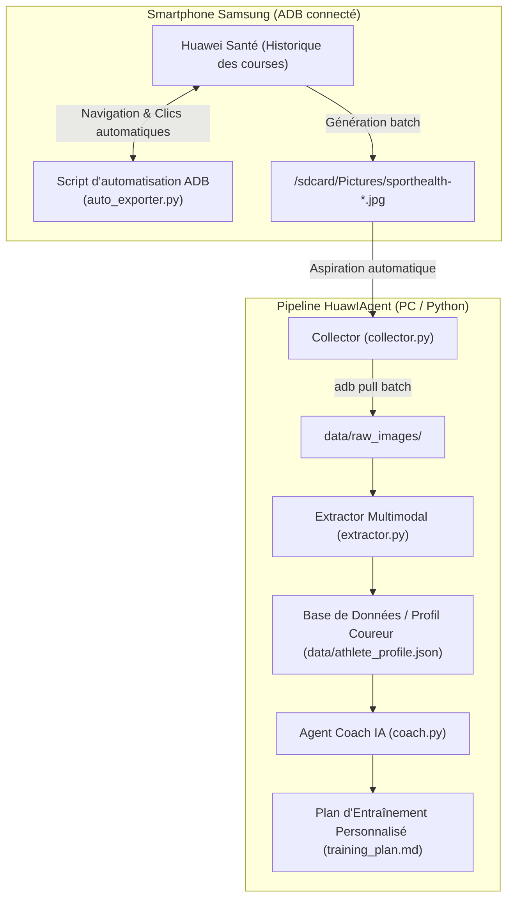

# Plan d'implémentation : Récupération globale des courses & Agent Coach IA (HuawIAgent)

## Objectif
1. **Récupérer l'ensemble de vos courses à pied** (historique et nouvelles) de manière automatisée sans compte développeur et sans licence payante.
2. **Extraire automatiquement 100% des métriques** (cardio, allures, VO2max, cadence, oscillation verticale, temps de contact au sol).
3. **Créer l'agent IA Coach** capable de concevoir et ajuster un plan d'entraînement sur-mesure (progression, prévention des blessures, calibrage des zones cardiaques).

---

## Architecture globale de HuawIAgent



---

## 1. Méthode pour récupérer TOUTES vos courses à pied

Pour récupérer toutes vos courses sans devoir appuyer manuellement 50 fois sur votre téléphone, nous mettons en place **deux approches complémentaires** :

### Approche A : Le Robot d'export automatique ADB (`auto_exporter.py`) - Immédiat
- **Principe** : Un script Python pilote l'écran de votre smartphone via ADB (`adb shell input tap`, `adb shell input swipe` et `uiautomator`).
- **Fonctionnement** :
  1. Le smartphone étant allumé sur l'onglet **Exercice / Historique** de Huawei Santé.
  2. Le script clique sur la 1ère course, fait *Partager > Enregistrer l'image*.
  3. Il revient en arrière, passe à la course suivante et recommence jusqu'à la fin de la liste.
  4. Toutes les fiches longues sont instantanément générées dans `/sdcard/Pictures/`.

### Approche B : L'archive RGPD globale (Dès sa réception)
- L'archive demandée tout à l'heure contient l'intégralité brute de toutes vos courses depuis la création de votre compte.
- Un module `json_importer.py` complètera automatiquement la base pour les activités très anciennes si besoin.

---

## 2. Structure des composants dans `HuawIAgent`

```text
HuawIAgent/
├── config.py                 # Configuration (chemins, objectifs coureur, clé API)
├── auto_exporter.py          # Robot ADB pour exporter automatiquement toutes les courses
├── collector.py              # Aspiration et synchronisation des fiches via ADB
├── extractor.py              # Extraction multimodale de toutes les métriques (cardio, foulée, VO2Max)
├── coach.py                  # Agent IA de planification d'entraînement personnalisé
├── data/
│   ├── raw_images/           # Fiches d'activités haute résolution (1080x13788px)
│   ├── runs/                 # Fichiers JSON individuels par course
│   └── athlete_profile.json  # Historique consolidé, records, fatigue, progression
└── run_pipeline.py           # Point d'entrée principal (orchestrateur en 1 commande)
```

---

## 3. Plan d'implémentation par étapes

### Étape 1 : Le collecteur ADB (`collector.py`)
- Détecte l'appareil connecté et télécharge automatiquement toutes les images `sporthealth-*.jpg` présentes sur le téléphone dans `data/raw_images/`.
- Déjà testé et validé avec la première image extraite aujourd'hui !

### Étape 2 : L'extracteur de métriques (`extractor.py`)
- Analyse la fiche d'activité (ou ses sections clés) et extrait un profil structuré :
  - Métriques d'allure (durée, distance, allure moyenne, allures par km).
  - Métriques cardiaques (FC moyenne, FC max, temps dans les 5 zones).
  - Métriques biomécaniques (cadence, oscillation verticale, temps au sol, symétrie G/D).
  - Métriques physiologiques (VO2Max, effet aérobie/anaérobie, récupération en heures).

### Étape 3 : Le Robot de batch export (`auto_exporter.py`)
- Automatise le défilement et le clic d'export dans Huawei Santé pour toutes vos séances passées.

### Étape 4 : L'Agent Coach d'entraînement (`coach.py`)
- Prend en entrée :
  1. Votre profil coureur consolidé.
  2. Vos objectifs (ex: préparer un 10 km, un semi, progresser sans blessure, courir 3x/semaine).
  3. Votre état de fatigue actuel (temps de récupération restant, charge d'entraînement).
- Génère un plan hebdomadaire précis avec :
  - Les allures cibles et zones cardiaques exactes pour chaque séance (fractionné, endurance fondamentale).
  - Des conseils biomécaniques ciblés (ex: augmenter la cadence pour réduire le temps de contact au sol).

---

## Plan de vérification

1. **Test unitaire de l'extracteur** : Valider sur `sample_sporthealth.jpg` que toutes les valeurs (VO2Max 65, FC 151, cadence 160, contact sol 298ms) sont parfaitement extraites.
2. **Vérification de la synchronisation** : Exécuter `collector.py` pour rapatrier la course du 25 octobre dès son enregistrement.
3. **Simulation du plan d'entraînement** : Générer une première recommandation d'entraînement pour tester la pertinence de l'agent coach.
